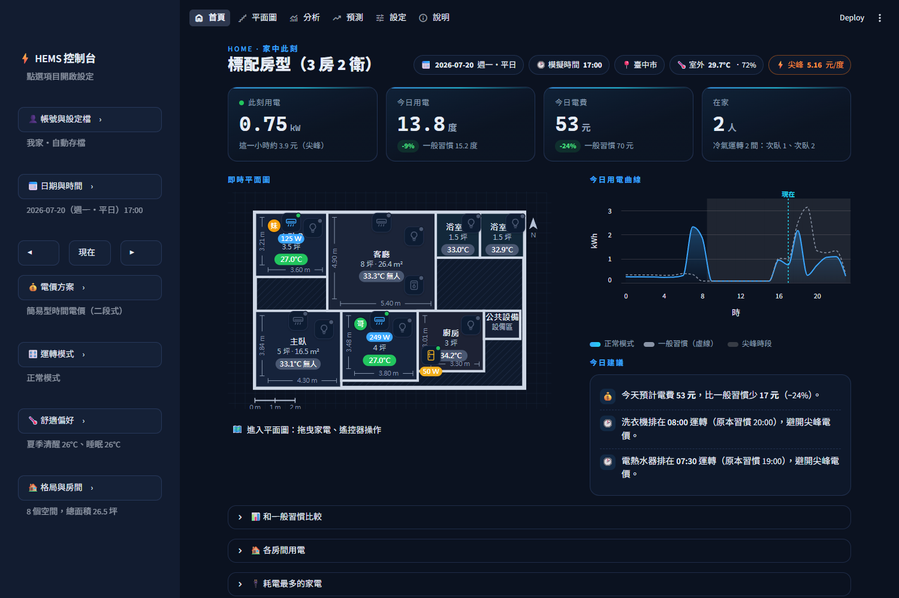
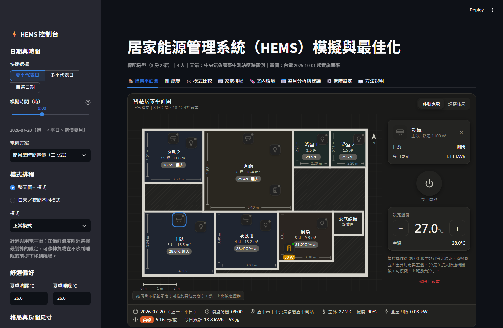
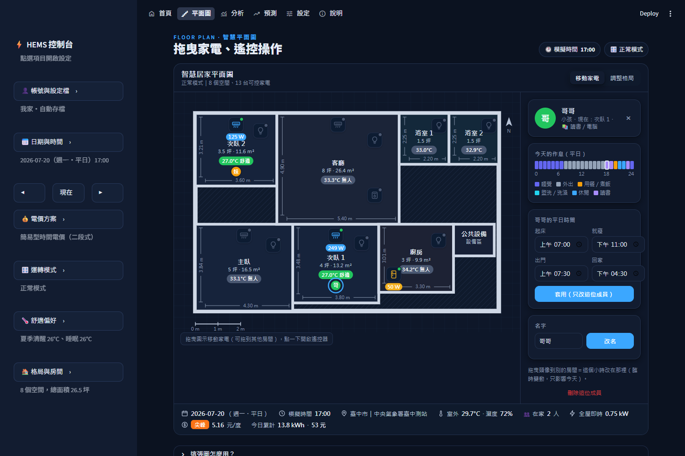

# 居家能源管理系統（HEMS）模擬與最佳化平台

[](https://github.com/Mark666941/hems/actions/workflows/tests.yml)

[](https://docs.astral.sh/ruff/)

以**物理模型**推演一個家庭 24 小時、每個房間的冷房負載與家電用電，並以**最佳化**在電費與舒適度之間取得平衡；
提供互動式介面，讓使用者客製化自己的房型、家電與作息，比較不同運轉模式的結果。

> 作者為冷凍空調系畢業生，修習綠建築課程時研究建築能源管理系統（BEMS），本專案將其應用於居家場域。



## 一眼看懂成果

以台中一家四口（雙薪、兩個小孩）、標配 3 房 2 衛為例，2026 年 7 月整月模擬（中央氣象署臺中測站實測天氣、台電現行電價）：

| 情境 | 月用電 | 月電費 | 舒適時間比例 |
|---|---|---|---|
| 一般習慣（有人就開冷氣、整天 25°C、晚上燒熱水洗衣） | 609 度 | 2,381 元（二段式時間電價） | 59% |
| **正常模式 ＋ 累進電價**（系統建議） | **549 度** | **1,647 元（−31%）** | **98%** |

- 一般習慣整夜 25°C，入睡後反而偏冷：**溫度範圍與 ISO 7730 PMV 兩種指標都判定「又耗電又不舒服」**。
- 雙薪家庭冷氣集中在晚間尖峰、無法移轉，**即使最佳化後，累進電價仍比時間電價便宜**——系統會依數據給出這類建議，而不是一律建議改時間電價。

## 主要功能

| 頁面 | 功能 |
|---|---|
| 🏠 **首頁** | 家中此刻：即時用電、今日用電與電費（與一般習慣比較）、在家人數、唯讀平面圖、今日用電曲線、今日建議 |
| 🗺️ **平面圖** | 建築平面圖（尺寸標註、室溫舒適標籤）；**拖曳家電**到其他房間、**遙控器**開關冷氣電燈（模擬立即重算）；**家庭成員依作息移動**，點選看個人作息、拖曳＝臨時變動 |
| 📊 **分析** | 今日明細、四種模式比較、家電排程甘特圖、各房間逐時室溫、整月分析與節省建議（可下載報告） |
| 📈 **預測** | 家電使用紀錄（每週習慣、每日紀錄、帳單度數）＋本月／下月用電與電費預測（含範圍、帳單修正） |
| ⚙️ **設定** | 房型（空間範本 × 數量）、家電功率、作息時間、比較基準 |
| 📍 **地區與天氣** | 臺中測站實測（離線）或 Open-Meteo：全台 368 個鄉鎮市區、含今天與未來 7 天預報；「現在」直接看今天 |
| 👤 **帳號與設定檔** | 自動存檔、多組設定檔（例如「我家」「爸媽家」）、匯出／匯入 JSON；網頁版需登入 |

| 平面圖：遙控器與家電 | 平面圖：家庭成員與個人作息 |
|---|---|
|  |  |

## 系統架構（五層）

```
輸入層   房型（範本 × 數量）、家庭作息、中央氣象署逐時天氣、台電電價          config/、data/、core/data_source.py、core/tariff.py
  ↓
模擬層   作息 → 每人每分鐘在哪個房間；冷房負載 → 冷氣耗電；其他家電依活動運轉  core/schedule.py、core/load_model.py、core/simulator.py
  ↓
最佳化層 四種模式＝同一套目標函數＋不同參數                                    core/optimizer.py、config/modes.json
  ↓
分析層   用電、電費、尖峰、需量、碳排、舒適度（PMV/PPD）、節省建議、模型校正   core/metrics.py
  ↓
介面層   Streamlit 多頁面＋自訂平面圖元件（HTML/SVG/JS）＋資料庫               app.py、ui/、core/storage.py
```

## 技術重點

### 冷房負載與冷氣耗電（冷凍空調專業）
- 冷房負載 = 外牆（**等效日射溫度＋牆體時滯與衰減**）＋窗戶傳熱與日射＋人體顯熱／潛熱（ASHRAE）
  ＋家電發熱＋外氣滲透（**濕空氣線圖計算潛熱**）＋開機時的**蓄熱與累積水氣移除**
- **日射依窗戶方位**：由日期、時間、經緯度算太陽位置，Erbs 法分離直射與散射，算出各方位牆面日射（西曬）
- **室內水氣平衡**：人體、洗澡、煮飯產生的水氣＋換氣－冷氣／除濕機移除，家具牆面吸放濕緩衝；除濕機依室內濕度運轉
- 冷氣耗電 = 冷房負載 ÷ COP；冷房能力與 COP 依**性能曲線**（室內濕球 × 室外乾球，EnergyPlus DX 曲線）、
  **能源效率等級**與**變頻部分負載率**（含低負載啟停損失）修正
- 冷氣沒開時，室溫以**一階熱響應（1R1C）**計算：時間常數 τ = 熱容量 C ÷ 熱傳係數 UA
- **房間之間的熱交換（RC 熱網路）**：相鄰關係由平面圖算出共用牆長，各房反覆計算到室溫收斂（Jacobi 迭代）
- 參數集中在 `config/load_params.json`，每個數值註明來源或標示「估計」

### 最佳化
- 四種模式（省電、正常、效能、舒眠）**不是寫死的規則**，而是同一個目標函數：
  `最小化 電費 + 舒適權重 × Σ 人數 × max(0, |室溫 − 偏好溫度| − 容許偏差)²`，搭配不同參數
- 冷氣設定溫度：**座標下降法**，每次以負載模型推演整天評估（室溫有蓄熱，前後小時互相影響）
- 可移轉負載（熱水器 × 洗衣機 × 烘衣機）：開始時間**聯合窮舉**（全域最佳），限制包含洗澡前燒好熱水
  （含儲水桶散熱損失）、烘衣接續洗衣、睡眠時段安靜、**需量懲罰**讓大功率家電錯開
- 舒眠模式：入睡後依睡眠曲線逐步調高設定溫度、起床前回溫
- **混合整數規劃（MILP）**：整間房子一起求解（隔間熱交換在方程式內）、每房每小時設定溫度、0/1 變數排可移轉負載，
  全屋尖峰需量一起考慮；以 scipy／HiGHS 求解，COP 以完整推演序列線性化。
  [比較報告](docs/reports/optimizer_comparison.md)：32 個夏季案例，總目標值改善 22.6%（舒適度提升為主）；
  同樣「分組」自由度時原本方法較準，顯示改善來自逐時控制

### 舒適度與驗證
- **ISO 7730 PMV/PPD** 熱舒適模型（以標準附錄範例驗證），與溫度範圍指標交叉驗證
- **ASHRAE Guideline 14** 模型校正指標（NMBE、CV(RMSE)），可用智慧插座／電表 CSV 比對模擬與實測

### 軟體工程
- **資料來源介面**：天氣與用電都有共同介面（`WeatherSource`、`MeterSource`），模擬資料與未來的感測器資料走同一個入口
- **資料層**：SQLAlchemy 同一套程式支援本機 SQLite 與雲端 PostgreSQL；密碼以 PBKDF2-SHA256 加鹽雜湊
- **自訂 Streamlit 元件**：平面圖以 HTML/SVG/JavaScript 撰寫，手寫元件通訊協定與 Python 雙向溝通
- **快取**：設定序列化為 JSON 作為快取 key；快取 key 放「房間相鄰關係」而非座標，拖曳圖示不重算
- **效能**：與設定溫度無關的計算抽出快取、純函式 lru_cache、常駐程序池多核心平行（每天一個工作，失敗自動退回逐一計算）；整月分析 58 → 2 秒，重構前後結果逐欄比對完全一致
- **測試**：256 項 pytest（物理公式、能量守恆、最佳化取捨、資料庫、介面 AppTest 等）

## 快速開始

需求：Windows、Python 3.11 以上。

```powershell
git clone https://github.com/Mark666941/hems.git
cd hems
python -m venv .venv
.\.venv\Scripts\Activate.ps1
pip install -r requirements-desktop.txt
```

**不想安裝 Python？** 使用 Windows 安裝程式 `HEMS-Setup-1.0.0.exe`（約 90 MB），雙擊安裝即可
（不需要系統管理員權限；資料存在 `%LOCALAPPDATA%\HEMS`，解除安裝時保留）。
自行製作安裝程式：`pip install pyinstaller`、`winget install JRSoftware.InnoSetup`，再執行 `python packaging/build_installer.py`。

開啟方式（擇一）：

| 方式 | 指令 |
|---|---|
| 桌面視窗 | `python run_app.py` |
| 瀏覽器 | `streamlit run app.py` |
| VS Code | 按 F5，選「HEMS 介面（桌面視窗）」 |
| 桌面捷徑 | `python scripts\make_icon.py`、`python scripts\create_shortcut.py`，之後雙擊桌面圖示 |

命令列工具：

```powershell
python -m core.simulator --month 2026-07     # 整月推演＋三種電價月電費
python -m core.optimizer 2026-07-20          # 四種模式比較
python -m core.metrics --month 2026-07       # 整月指標、節省建議、Markdown 報告
python -m core.metrics --calibrate data/meter/demo_synthetic_2026-07.csv   # ASHRAE Guideline 14 模型校正示範
pytest -q                                    # 全部測試
```

網頁版部署：設定環境變數 `HEMS_DATABASE_URL`（或 Streamlit secrets 的 `database.url`）為 PostgreSQL 網址即會啟用帳號登入；
本機可用 `HEMS_REQUIRE_LOGIN=1` 展示登入流程。

## 專案結構

```
hems/
├── app.py                 # Streamlit 入口：主題、左側設定選單、頂端導覽
├── run_app.py             # 一鍵啟動（桌面視窗／瀏覽器）
├── core/                  # 模型與演算法（不依賴介面）
│   ├── models.py          # 空間、家電、房屋、家庭成員
│   ├── data_source.py     # 資料來源介面（天氣、用電：模擬／感測器）
│   ├── tariff.py          # 台電電價：時段、費率、離峰日、月電費
│   ├── schedule.py        # 作息：每人每分鐘的位置與活動
│   ├── load_model.py      # 冷房負載、冷氣 COP、家電耗電、可移轉工作
│   ├── simulator.py       # 24 小時推演引擎（ControlPlan → SimulationResult）
│   ├── optimizer.py       # 四種模式的最佳化
│   ├── metrics.py         # 指標、PMV/PPD、模式比較、節省建議、模型校正
│   └── storage.py         # 資料層：帳號與設定檔
├── ui/                    # 介面：頁面、圖表、平面圖元件、設定轉換、帳號
├── config/                # 房型範本、家電、作息、模式參數、電價、負載參數（JSON）
├── data/                  # 中央氣象署逐時天氣（2026 年 1–9 月）、示範電表資料
├── scripts/               # 天氣下載、圖示與桌面捷徑、夜間自動任務
├── docs/                  # 圖表與報告範例
└── tests/                 # pytest
```

## 資料來源

- 天氣：中央氣象署 CODiS 臺中測站（467490）逐時觀測，2026 年 1–9 月；Open-Meteo（再分析＋預報，免金鑰）
- 鄉鎮市區中心點：內政部國土測繪中心「鄉鎮市區界線（TWD97 經緯度）」
- 電價：台電「各類電價表及計算範例」（114 年 10 月 1 日起實施）
- 人體發熱：ASHRAE Fundamentals；熱舒適：ISO 7730；模型校正：ASHRAE Guideline 14
- 碳排係數：經濟部能源署 113 年度電力排碳係數（0.474 kg CO2e/度）

## 限制與未來方向

- 系統只模擬冷氣，沒有暖氣（台中冬季少用暖氣）；冬季舒適度主要受天氣影響
- 房間之間的熱交換只計隔間牆傳熱，未計房門與走道的空氣交換
- 參數為台灣常見 RC 公寓典型值，可用智慧插座／電表實測資料依 ASHRAE Guideline 14 校正
- 規劃中：MILP 解作為起點、在完整推演上逐時局部搜尋；真實智慧插座串接
