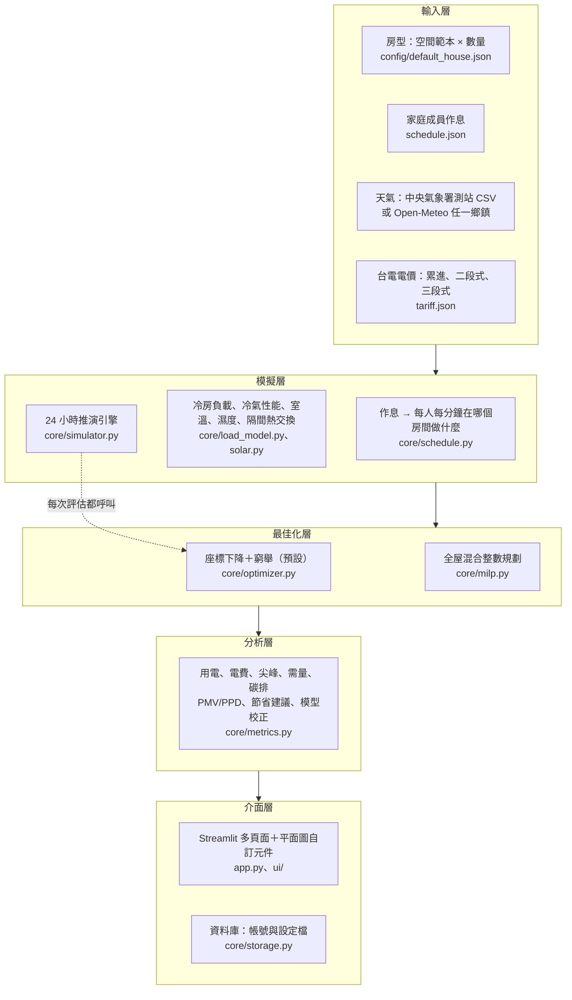

# 居家能源管理系統（HEMS）模擬與最佳化平台：專案報告

> 作者：重｜原始碼：<https://github.com/Mark666941/hems>
> 報告日期：2026 年 10 月｜程式規模：核心 4,200 行、介面 3,800 行＋平面圖 JavaScript 700 行、測試 3,100 行（258 項）

---

## 1. 摘要

本專案以**物理模型**推演一個家庭 24 小時、每個房間的冷房負載與家電用電，並以**最佳化**在電費與舒適度之間取得平衡；
使用者可在互動介面中客製化房型、家電、家庭成員作息、電價方案與所在地區，比較不同運轉模式的結果。

| 項目 | 成果 |
|---|---|
| 節省效果（台中、一家四口、2026 年 7 月） | 一般習慣 635 度／2,469 元 → 系統建議 568 度／**1,744 元（−29%）**，舒適時間 59% → **98%** |
| 模型驗證（台電公開資料） | 與全國住宅每戶用電的季節變化相關係數 **0.86**；夏冬用電比 1.41（實際 1.47） |
| 用電預測 | 物理＋機器學習混合模型 MAPE **6.4%**（純物理 7.3%、純機器學習 7.4%） |
| 最佳化升級 | MILP＋局部搜尋混合最佳化在 32 個夏季案例中，84% 優於原方法，總目標值改善 **40.2%** |
| 效能 | 整月分析（31 天 × 5 種情境，每天各自最佳化）**58 秒 → 2 秒** |
| 軟體工程 | 258 項自動測試、GitHub Actions、桌面版／網頁版／Windows 安裝程式三種發佈方式 |

---

## 2. 背景、動機與目標

- **動機**：修習綠建築課程時研究建築能源管理系統（BEMS）。BEMS 多用於大型建築，住宅缺乏能讓一般家庭
  「看懂用電、知道怎麼省」的工具，因此將 BEMS 的概念（負載模擬、排程最佳化、指標分析）應用到居家場域。
- **專業結合**：以冷凍空調背景建立冷房負載與冷氣性能模型（外殼傳熱、日射、潛熱、濕空氣、COP），
  再以資訊技術（最佳化、機器學習、資料庫、網頁介面）把模型變成可操作的系統。
- **現階段**：模擬與推演（不接實體感測器）。程式已預留**資料來源介面**，未來接智慧插座、電表時，
  感測器資料與模擬資料走同一個入口，模型與介面不需改寫。

---

## 3. 系統架構

### 3.1 五層架構



**設計原則**：`core/` 只放計算、不依賴介面（可單獨用命令列執行與測試）；介面只修改「設定字典」，
不寫回 `config/` 的 JSON，預設值永遠保留；所有參數集中在 JSON，每個數值註明來源或標示「估計」。

### 3.2 模組地圖

| 層 | 模組 | 職責 |
|---|---|---|
| 輸入 | `core/models.py` | 空間範本、家電、房屋、成員資料結構；房屋 = 範本 × 數量（不寫死房型） |
| 輸入 | `core/data_source.py` | 資料來源介面：天氣（測站 CSV／Open-Meteo）、電表（CSV）；模擬與感測器同一介面 |
| 輸入 | `core/tariff.py` | 台電電價：時段、費率、離峰日（含國定假日）、累進級距、月電費 |
| 模擬 | `core/schedule.py` | 作息 → 每人每分鐘的位置與活動、每房每小時人數 |
| 模擬 | `core/load_model.py` | 冷房負載、冷氣性能曲線、家電耗電、室溫、室內濕度、隔間熱交換、線性化模型 |
| 模擬 | `core/solar.py` | 太陽位置、直射／散射分離、各方位牆面日射 |
| 模擬 | `core/simulator.py` | 24 小時推演（控制策略 → 推演結果）、房間耦合迭代、整月推演 |
| 最佳化 | `core/optimizer.py` | 四種模式（同一目標函數＋不同參數）的最佳化、統一評估 |
| 最佳化 | `core/milp.py` | 全屋混合整數規劃（scipy／HiGHS） |
| 分析 | `core/metrics.py` | 指標、PMV/PPD、模式比較、節省建議、ASHRAE Guideline 14 校正 |
| 效能 | `core/parallel.py` | 多核心平行（依容器 CPU 與記憶體上限決定子程序數） |
| 資料 | `core/storage.py` | SQLAlchemy：帳號（加鹽雜湊）、設定檔、家電使用紀錄 |
| 介面 | `app.py`、`ui/` | 頁面、圖表、平面圖元件、帳號、引導、預測、異常偵測、情境比較、PDF 報告 |

### 3.3 一次推演的資料流程

```mermaid
sequenceDiagram
  participant UI as 介面（app.py）
  participant OPT as 最佳化器
  participant SIM as 推演引擎
  participant LM as 負載模型
  UI->>OPT: 日期、模式、電價方案
  OPT->>SIM: 以偏好溫度推演一次，取得各房室溫
  loop 每個有冷氣的房間 × 每個候選設定溫度
    OPT->>LM: 設定溫度、冷氣開關、鄰房室溫
    LM-->>OPT: 冷氣耗電、室溫 → 電費＋舒適懲罰
  end
  OPT->>OPT: 可移轉負載窮舉（熱水器 × 洗衣 × 烘衣）
  OPT->>SIM: 最佳控制策略
  loop 房間耦合迭代（直到室溫變化 < 0.05°C）
    SIM->>LM: 各房間逐時計算（鄰房上一輪室溫）
  end
  SIM-->>UI: 逐時用電、電費、室溫、濕度、家電排程
```

### 3.4 部署架構

| 版本 | 執行方式 | 資料庫 | 登入 |
|---|---|---|---|
| 桌面版 | `python run_app.py`（pywebview 視窗）、雙擊捷徑、VS Code F5 | 本機 SQLite | 免登入 |
| 安裝程式 | `HEMS-Setup-1.0.0.exe`（PyInstaller＋Inno Setup，91 MB，免系統管理員） | `%LOCALAPPDATA%\HEMS` | 免登入 |
| 網頁版 | Streamlit Community Cloud（步驟見 `docs/deploy.md`） | Supabase PostgreSQL（SSL） | 註冊／登入、示範帳號 |

同一份程式碼，以資料庫網址（環境變數或 Streamlit secrets）切換本機或雲端。

---

## 4. 功能說明

| 頁面 | 功能 |
|---|---|
| 🏠 首頁「家中此刻」 | 即時用電、今日用電與電費（與一般習慣比較）、在家人數、唯讀平面圖、今日用電曲線、今日建議 |
| 🗺️ 平面圖 | 建築平面圖（尺寸、室溫舒適標籤）；拖曳家電換房間、遙控器開關冷氣與電燈（立即重算）；家庭成員依作息移動，點選看個人作息、拖曳為臨時變動；一天動畫播放 |
| 📊 分析 | 今日明細、四種模式比較、家電排程甘特圖、室內溫濕度、整月分析（每日用電折線、累積電費、溫度與冷氣用電迴歸）與數據式建議、PDF 報告、情境比較（換設備的投資回收年限）、用電異常偵測 |
| 📈 預測 | 家電使用紀錄（每週習慣、每日紀錄、帳單度數）；本月／下月用電與電費（含範圍）；帳單與模擬比對，由使用者決定是否修正 |
| ⚙️ 設定 | 房型（空間範本、面積、窗戶方位）、家電功率、冷氣能力與能效等級、作息時間 |
| 左側選單 | 帳號與設定檔（多組、自動存檔、匯出匯入）、新手引導、日期時間、地區與天氣（全台 368 鄉鎮市區）、電價方案（說明與月電費試算）、運轉模式（含白天／夜間自動切換、最佳化方法）、舒適偏好、格局 |

**四種模式**不是寫死的規則，而是同一個目標函數搭配不同參數（`config/modes.json`）：

| 模式 | 設定溫度範圍 | 舒適權重 | 特色 |
|---|---|---|---|
| 省電 | 26–29°C | 0.3 | 放寬舒適、照明調暗、除濕機關閉、家電全部移到離峰 |
| 正常 | 25–28°C | 2.0 | 舒適與用電平衡，睡眠時段不運轉洗衣烘衣 |
| 效能 | 23–27°C | 20（容許偏差 0°C） | 舒適優先、回家前 1 小時預冷、家電不移轉 |
| 舒眠 | 25–28°C | 2.0 | 入睡後依睡眠曲線逐步調高設定溫度、起床前回溫 |

---

## 5. 核心技術

### 5.1 冷房負載與室內環境（冷凍空調專業）

**冷房負載**（每房每小時）＝ 外牆 ＋ 窗戶傳熱 ＋ 窗戶日射 ＋ 人體顯熱／潛熱 ＋ 家電發熱 ＋ 外氣滲透 ＋ 蓄熱移除 ＋ 累積水氣移除 ＋ 隔間熱交換

| 項目 | 方法 |
|---|---|
| 外牆 | 等效日射溫度（sol-air）＋牆體時滯 4 h 與衰減 0.4（15 cm RC 牆，ASHRAE 典型範圍） |
| 日射 | 依日期、時間、經緯度算太陽高度角與方位角；Erbs 相關式分離直射與散射；垂直面日射 = 直射 × cos 入射角 + 天空散射 + 地面反射。結果：朝西房間夏季冷氣用電 +30%（西曬） |
| 人體 | ASHRAE Fundamentals 依活動的顯熱／潛熱；兒童 0.75 倍 |
| 滲透與潛熱 | 換氣次數 × 濕空氣線圖（Magnus 飽和水氣壓 → 絕對濕度） |
| 室溫（冷氣沒開） | 一階熱響應 1R1C：時間常數 τ = 熱容量 C ÷ 熱傳係數 UA；開窗、排風扇改變 UA |
| 室內濕度 | 逐時水氣平衡：人體、洗澡、煮飯產生 ＋ 換氣帶入 − 冷氣或除濕機移除；家具牆面吸放濕緩衝 |
| 隔間熱交換 | RC 熱網路：相鄰關係由平面圖算出共用牆長，Q = U × 牆面積 × 溫差；各房反覆計算到收斂（Jacobi） |

**冷氣耗電** ＝ 冷房負載 ÷ COP：
- **性能曲線**：EnergyPlus DX 冷氣曲線，能力與耗電比隨「室內濕球 × 室外乾球」二次曲面變化，以 CNS 14464 額定條件正規化
- **能源效率等級** 1–5 級對應額定 COP；可設定冷氣能力（kW），依坪數建議規格
- **變頻部分負載**：負載率高於最低值時效率提升，低於時壓縮機啟停效率下降

### 5.2 最佳化

**目標函數**（四種模式共用）：

```
最小化  電費 + Σ 舒適權重 × 人數 × max(0, |室溫 − 偏好溫度| − 容許偏差)² + 需量權重 × 最大用電
```

| 方法 | 決策 | 求解 |
|---|---|---|
| 座標下降（預設） | 每房每時段一個設定溫度（0.5°C 間隔） | 輪流固定其他變數，在候選值中找最好的；每次用完整推演評估（室溫有蓄熱，前後小時互相影響） |
| 可移轉負載 | 熱水器、洗衣機、烘衣機開始時間 | 0.5 小時間隔窮舉數千種組合（全域最佳）；限制：洗澡前燒好熱水（含儲水桶散熱）、烘衣接續洗衣、睡眠時段安靜 |
| 混合整數規劃（MILP） | 每房每小時室溫與供冷（連續）、家電開始時間（0/1） | 全屋一個模型（隔間熱交換在方程式內）、平方懲罰分段線性化、scipy／HiGHS 求解；COP 以完整推演序列線性化（MPC 常用） |

**比較結果**（`docs/reports/optimizer_comparison.md`，32 個夏季案例，兩種方法都交給同一個完整推演驗算）：

| 方法 | 電費（元／天） | 舒適懲罰（元／天） | 總目標值 |
|---|---|---|---|
| 座標下降（原本） | 55.2 | 188.3 | 248.9 |
| MILP 逐時 | 57.3 | 129.9 | **192.7（−22.6%）** |
| MILP 分組（與原本相同自由度） | 56.6 | 232.2 | 294.4 |
| **MILP＋局部搜尋** | 56.0 | **87.4** | **148.7（−40.2%）** |

**解讀**：改善來自「逐時調整設定溫度」；在相同自由度下，直接以完整（非線性）推演搜尋的座標下降比線性化 MILP 準確。
這是模型預測控制常見的「模型精度 vs 決策自由度」取捨；**混合法**以 MILP 解為起點、在完整推演上逐時微調，兩者兼得。

### 5.3 分析、預測與驗證

| 功能 | 方法 |
|---|---|
| 熱舒適 | ISO 7730 PMV／PPD（以標準附錄範例驗證），與溫度範圍指標交叉驗證 |
| 模型校正 | ASHRAE Guideline 14：NMBE、CV(RMSE)，可匯入智慧插座／電表 CSV 比對 |
| 真實資料驗證 | 台電公開資料（全國住宅每戶平均用電 2018–2026、台中住宅總用電）比較季節形狀與量級 |
| 用電預測 | 物理模擬為特徵＋梯度提升樹修正殘差的混合模型；時間序列交叉驗證（5 折、每折預測未來 12 個月） |
| 異常偵測 | 「實測 − 模擬」誤差的穩健統計門檻（中位數 ± k × 1.4826 MAD），分單一小時、持續偏離、整天偏離；系統性偏差不算異常 |
| 情境比較 | 換一級冷氣、LED、熱泵熱水器、冷氣調高 1°C：取樣推演一整年，算回收年限與使用年限淨效益 |
| 節省建議 | 依整月數據產生：綜合建議、模式、離峰移轉、耗電大戶、電價方案、冷氣溫度，並標明彼此重疊關係 |

---

## 6. 驗證與成果

### 6.1 與台電真實資料比較（2026 年 1–9 月，標配房型、一般習慣）

| 月份 | 1 | 2 | 3 | 4 | 5 | 6 | 7 | 8 | 9 |
|---|---|---|---|---|---|---|---|---|---|
| 模擬（4 人家庭，度） | 449 | 396 | 416 | 445 | 552 | 574 | 634 | 632 | 588 |
| 全國每戶平均（度） | 238 | 232 | 251 | 244 | 262 | 289 | 350 | 382 | 389 |

- 季節相關係數：0.82（初版）→ **0.86**（加入西曬、濕度、隔間熱交換後）
- 夏冬用電比：1.23 → **1.41**（實際 1.47）；初版低估夏季冷氣的除濕用電
- 量級約全國平均 1.5–1.9 倍：全國平均每戶約 2.6 人，模擬為 4 人且使用電熱水器
- 實際高峰晚 1–2 個月：台電住宅多為兩個月抄表一次

### 6.2 整月模式比較（2026 年 7 月，台中）

| 模式 | 月用電（度） | 二段式時間電價（元） | 累進電價（元） | 舒適時間 | PMV 舒適比例 |
|---|---|---|---|---|---|
| 一般習慣 | 635 | 2,469 | 2,087 | 59% | 65% |
| 省電 | 501 | 1,697 | 1,401 | 72% | 18% |
| 正常 | 568 | 1,947 | **1,744** | **98%** | 93% |
| 效能 | 582 | 2,305 | 1,817 | 100% | 100% |
| 舒眠 | 573 | 1,972 | 1,771 | 98% | 93% |

系統的綜合建議：「改用正常模式並換成累進電價，每月 2,469 → 1,744 元（−29%），舒適時間 59% → 98%」。
雙薪家庭冷氣集中在晚間尖峰且無法移轉，因此即使最佳化後，累進電價仍比時間電價便宜。
系統依數據給出建議，而不是一律建議改用時間電價。

### 6.3 效能

| 項目 | 改善前 | 改善後 |
|---|---|---|
| 單日推演 | 0.07 秒 | 0.02 秒 |
| 單日單模式最佳化 | 0.19 秒 | 0.06 秒 |
| 整月分析（31 天 × 5 情境） | 58 秒 | **2.0 秒**（介面上 2.2–2.7 秒） |

做法：與設定溫度無關的計算抽出快取、純函式 `lru_cache`、最佳化不建立 DataFrame、常駐程序池多核心平行。
重構前後三個代表日的推演與最佳化結果**逐欄比對完全一致**。

---

## 7. 軟體工程

| 面向 | 做法 |
|---|---|
| 測試 | 258 項 pytest：物理公式（PMV 標準範例、濕空氣、太陽位置）、能量守恆（隔間熱流總和為 0）、最佳化取捨、資料庫、平行＝單核心、介面 Streamlit AppTest 各頁面 |
| 持續整合 | GitHub Actions（Linux＋Python 3.11）每次 push 執行 ruff 與全部測試；曾抓到 Windows 上測不出的跨版本差異 |
| 資料層 | SQLAlchemy 一套程式支援 SQLite／PostgreSQL；密碼 PBKDF2-SHA256 加鹽；自動存檔、多設定檔、匯出入 |
| 自訂元件 | 平面圖以 HTML／SVG／JavaScript 撰寫，手寫 Streamlit 元件通訊協定與 Python 雙向溝通 |
| 快取 | 設定 JSON 為快取 key；放「房間相鄰關係」而非座標，拖曳圖示不重算 |
| 平行 | 常駐程序池、spawn、依容器 CPU 配額與記憶體上限決定子程序數、失敗自動退回逐一計算 |
| 錯誤處理 | 單一頁面出錯只顯示錯誤、不影響其他頁；輪替記錄檔；自動存檔失敗提示重試 |
| 發佈 | 桌面版（pywebview）、Windows 安裝程式（PyInstaller＋Inno Setup，繁體中文精靈）、網頁版（Streamlit Cloud＋Supabase） |
| 文件 | README、開發者文件（`docs/developer_guide.md`）、部署說明、各項比較報告；參數 JSON 每個數值註明來源或「估計」 |

---

## 8. 限制

1. **參數多為典型值或估計**：外殼 U 值、換氣次數、吸濕緩衝、能效等級對應 COP、隔間 U 值等，
   需要實測資料（智慧插座、電表、溫濕度計）依 ASHRAE Guideline 14 校正。
2. **台電公開資料不是同一戶**：只能驗證季節形狀與量級，無法驗證單一家庭的逐時用電。
3. **只模擬冷氣**：沒有暖氣（台中冬季少用）；冬季舒適度主要受天氣影響。
4. **隔間熱交換只計牆體傳熱**：房門、走道的空氣交換未計。
5. **線性化 MILP 的模型落差**：變頻 COP、開機除濕、除濕機在線性模型中固定，省電導向的模式原方法略優。
6. **天氣**：Open-Meteo 為 9–25 km 網格，與市區測站約差 1°C（熱島效應）。
7. **雲端免費方案**：約 1 GB 記憶體、閒置休眠；多人同時使用需升級主機。

---

## 9. 未來優化方向

| 優先 | 方向 | 內容 | 預期效益 |
|---|---|---|---|
| 1 | **接入真實感測器** | 智慧插座（如 Tapo、Shelly）、智慧電表 AMI、溫濕度計，透過既有 `MeterSource`／`WeatherSource` 介面 | 用實測資料校正模型參數（Guideline 14），驗證單一家庭逐時用電 |
| 2 | **參數自動校正** | 以實測資料用貝氏最佳化或最小平方法估計 U 值、換氣、熱容量 | 模型從「典型家庭」變成「你的家」 |
| 3 | **滾動式 MPC** | 每小時用最新天氣預報與實測室溫重新最佳化接下來 24 小時 | 從「日前排程」變成「即時控制」 |
| 4 | **實際控制** | 透過紅外線遙控器（如 Broadlink）或 Matter 協定送出冷氣設定 | 從建議變成自動執行 |
| 5 | **機器學習強化** | 加入去年同月、氣溫距平等特徵；以多戶資料訓練 | 預測誤差低於「去年同月」基準 |
| 6 | **模型擴充** | 暖氣與熱泵、房門氣流、頂樓與屋頂日射、太陽能與儲能 | 適用更多房型與季節 |
| 7 | **時間電價需量反應** | 台電需量反應方案、電動車充電排程 | 更多可移轉負載與收益 |
| 8 | **多戶比較與社群** | 匿名比較同區、同規模家庭的用電 | 提供參考基準與行為誘因 |
| 9 | **行動版 App** | PWA 或原生 App、推播通知（異常用電、尖峰提醒） | 日常使用更方便 |

---

## 10. 面試可能的提問與回答重點

**Q：為什麼用物理模型，不直接用機器學習？**
A：一般家庭沒有逐時用電資料，純資料模型無從訓練；物理模型能回答「如果換一級冷氣、調高 1°C 會怎樣」這類
資料裡沒有出現過的情境。兩者可以互補：我用物理模擬當特徵、機器學習修正殘差，混合模型誤差 6.4%，
優於純物理 7.3% 與純機器學習 7.4%。我也誠實呈現：最簡單的「去年同月」基準是 6.0%，下一步要把它加入特徵。

**Q：四種模式怎麼設計？**
A：不是四套規則，而是同一個目標函數（電費＋舒適懲罰）搭配不同參數（溫度範圍、舒適權重、容許偏差、
可否移轉家電）。新增模式只要改 JSON，不用改程式。

**Q：最佳化為什麼不用一開始就用 MILP？**
A：室溫有蓄熱、COP 隨負載率變化，問題是非線性的。座標下降直接在完整模型上搜尋，簡單可靠；
MILP 要先把模型線性化。我實作兩者並在 32 個案例中比較：MILP 逐時控制改善 22.6%，但在相同自由度下
座標下降更準。這說明改善來自逐時控制，也讓我理解模型精度與決策自由度的取捨。

**Q：如何確認模型正確？**
A：三層驗證。（1）公式層：PMV 以 ISO 7730 附錄範例驗證、太陽位置以夏至冬至驗證、能量守恆測試；
（2）系統層：與台電公開資料的季節相關係數 0.86；（3）工程層：258 項自動測試、重構前後結果逐欄比對。

**Q：效能怎麼從 58 秒變 2 秒？**
A：先用 cProfile 找瓶頸：最佳化反覆呼叫負載模型、每次都建 pandas 表格。把與設定溫度無關的計算抽出快取
（單核心 58 → 9.4 秒），再用程序池讓 31 天平行（→ 2 秒）。部署到雲端時注意容器記憶體只有 1 GB，
子程序數依 cgroup 上限決定，避免記憶體不足。

**Q：冷凍空調背景在專案中的角色？**
A：冷房負載拆解、濕空氣線圖算潛熱、冷氣性能曲線（濕球溫度、部分負載）、牆體時滯衰減、熱舒適 PMV，
都是空調課程的內容；資訊技術讓這些計算能被一般使用者操作與比較。

---

## 附錄：常用指令與文件

| 用途 | 指令／檔案 |
|---|---|
| 開啟桌面版 | `python run_app.py` 或雙擊桌面 HEMS 圖示 |
| 開啟網頁版（本機） | `streamlit run app.py` |
| 整月分析報告 | `python -m core.metrics --month 2026-07` |
| 最佳化方法比較 | `python scripts/compare_optimizers.py` → `docs/reports/optimizer_comparison.md` |
| 用電預測模型比較 | `python scripts/ml_forecast.py` → `docs/reports/ml_forecast.md` |
| 製作安裝程式 | `python packaging/build_installer.py` → `build/installer/HEMS-Setup-1.0.0.exe` |
| 部署到網路 | `docs/deploy.md` |
| 開發者文件 | `docs/developer_guide.md` |
| 全部測試 | `pytest -q` |
