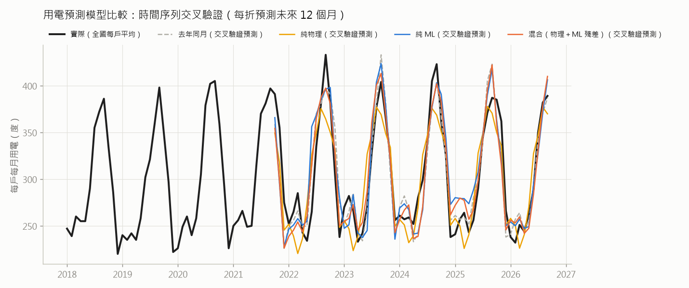

# 用電預測模型比較（優化方案 B1b）

產生日期：2026-10-17｜由 `python scripts/ml_forecast.py` 產生｜目標：全國住宅每戶每月平均用電（2018-01 起）

## 結果（時間序列交叉驗證 5 折，每折預測未來 12 個月的平均）

| 模型 | MAE（度） | MAPE（%） |
|---|---|---|
| 去年同月 | 18.1 | 6.0 |
| 混合（物理＋ML 殘差） | 19.1 | 6.4 |
| 純物理 | 21.9 | 7.3 |
| 純 ML | 21.8 | 7.4 |

- 最準的是 **去年同月**（MAPE 6.0%）；純物理 MAPE 7.3%。
- 純物理只用模擬的季節形狀（線性換算量級），不知道逐年的變化；ML 能學到趨勢與去年同月的水準，混合模型則讓 ML 只修正物理模型「沒解釋到」的部分。

## 各折明細

| 折 | 測試期間 | 模型 | MAE（度） | MAPE（%） |
|---|---|---|---|---|
| 1 | 2021-10～2022-09 | 去年同月 | 26.2 | 8.4 |
| 1 | 2021-10～2022-09 | 純物理 | 33.0 | 10.8 |
| 1 | 2021-10～2022-09 | 純 ML | 31.2 | 10.3 |
| 1 | 2021-10～2022-09 | 混合（物理＋ML 殘差） | 29.7 | 9.7 |
| 2 | 2022-10～2023-09 | 去年同月 | 17.6 | 6.1 |
| 2 | 2022-10～2023-09 | 純物理 | 25.5 | 8.7 |
| 2 | 2022-10～2023-09 | 純 ML | 21.0 | 7.2 |
| 2 | 2022-10～2023-09 | 混合（物理＋ML 殘差） | 15.4 | 5.3 |
| 3 | 2023-10～2024-09 | 去年同月 | 19.7 | 6.5 |
| 3 | 2023-10～2024-09 | 純物理 | 17.8 | 5.4 |
| 3 | 2023-10～2024-09 | 純 ML | 16.8 | 5.5 |
| 3 | 2023-10～2024-09 | 混合（物理＋ML 殘差） | 15.1 | 5.0 |
| 4 | 2024-10～2025-09 | 去年同月 | 13.9 | 4.7 |
| 4 | 2024-10～2025-09 | 純物理 | 14.9 | 5.2 |
| 4 | 2024-10～2025-09 | 純 ML | 24.2 | 8.7 |
| 4 | 2024-10～2025-09 | 混合（物理＋ML 殘差） | 17.9 | 6.2 |
| 5 | 2025-10～2026-09 | 去年同月 | 13.0 | 4.3 |
| 5 | 2025-10～2026-09 | 純物理 | 18.1 | 6.1 |
| 5 | 2025-10～2026-09 | 純 ML | 16.1 | 5.2 |
| 5 | 2025-10～2026-09 | 混合（物理＋ML 殘差） | 17.3 | 5.6 |

## 物理特徵：標配房型每天平均模擬用電（一般習慣，度）

| 1 月 | 2 月 | 3 月 | 4 月 | 5 月 | 6 月 | 7 月 | 8 月 | 9 月 | 10 月 | 11 月 | 12 月 |
|---|---|---|---|---|---|---|---|---|---|---|---|
| 14.5 | 14.1 | 13.4 | 14.8 | 17.8 | 19.1 | 20.5 | 20.4 | 19.6 | 19.6 | 14.5 | 14.5 |

## 方法與限制

- 特徵只用預測當下已知的資訊：月份（sin/cos 週期編碼）、時間趨勢、去年同月用電（台電資料內附）、物理模擬值。
- 物理特徵包含當月與上月：台電住宅多為兩個月抄表一次，月統計反映部分前一個月的用電。
- 天氣資料只有 2026 年 1–9 月，物理特徵是各月份的典型值（10–12 月用最接近月份的天氣），不含逐年天氣差異；補齊歷年天氣後可再提升物理與混合模型。
- 全國平均不是同一戶的資料，這裡驗證的是「模型能不能抓到真實住宅用電的季節與趨勢」，不是單一家庭的準確度。
