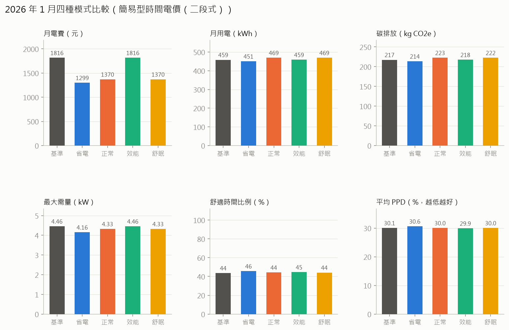

# 2026 年 1 月 HEMS 模式比較與節省建議

- 房型：標配房型（3 房 2 衛），4 人
- 電價方案：簡易型時間電價（二段式）（各模式依此方案最佳化）
- 天氣：中央氣象署臺中測站逐時觀測資料
- 碳排係數：0.474 kg CO2e/kWh（經濟部能源署 113 年度（2024）電力排碳係數）

## 模式比較

| 模式 | 月用電(kWh) | 簡易型時間電價（二段式）(元) | 簡易型時間電價（三段式）(元) | 非時間電價（累進電價，住宅用）(元) | 平均舒適時間比例(%) | 平均溫差(°C) | 最大需量(kW) | 碳排放(kg) | 平均PPD(%) | PMV舒適比例(%) | 月電費節省(%) |
|---|---|---|---|---|---|---|---|---|---|---|---|
| 基準（一般習慣） | 458.7 | 1815.6 | 1688.9 | 1091.0 | 43.6 | 2.1 | 4.5 | 217.4 | 30.1 | 35.2 | 0.0 |
| 省電模式 | 450.7 | 1299.1 | 1249.0 | 1065.9 | 45.6 | 2.1 | 4.2 | 213.6 | 30.6 | 35.1 | 28.4 |
| 正常模式 | 469.5 | 1370.1 | 1314.9 | 1124.8 | 44.2 | 2.1 | 4.3 | 222.5 | 30.0 | 35.0 | 24.5 |
| 效能模式 | 459.0 | 1816.2 | 1689.5 | 1091.8 | 44.6 | 2.1 | 4.5 | 217.5 | 29.9 | 36.5 | -0.0 |
| 舒眠模式 | 469.4 | 1369.9 | 1314.7 | 1124.5 | 44.2 | 2.1 | 4.3 | 222.5 | 30.0 | 35.0 | 24.6 |

## 節省建議（依每月可省金額排序）

1. **綜合建議：每月約省 750 元（8 度）**  
   改用省電模式並換成非時間電價（累進電價，住宅用）：每月電費 1816 → 1066 元（−41%），碳排放減少 4 kg CO2e，舒適度大致維持不變。  
   ※ 以下各項建議彼此有重疊，請勿直接相加。
2. **改用省電模式：每月約省 517 元（8 度）**  
   各模式都無法達到 95% 舒適時間（此季節室溫主要受天氣影響，系統沒有暖氣可調），選電費最低者；舒適時間由 44% 變為 46%，PMV 舒適比例 35% → 35%。  
   ※ 此季節冷氣幾乎不開，節省主要來自可移轉負載排程與照明調整。
3. **耗電大戶：電熱水器（占 37%）：每月約省 464 元（117 度）**  
   電熱水器換成熱泵熱水器（COP 約 3–4）（設備投資，需評估回收年限）。  
   ※ 以基準用電估算；設備改善與行為改善可疊加，但比例會縮小。
4. **熱水與洗衣移到離峰：每月約省 451 元（用電量不變，省在電價）**  
   電熱水器、洗衣機、烘衣機用定時器排在離峰時段（已計入熱水器提早燒的散熱損失），並錯開運轉以降低最大需量。  
   ※ 已包含在「改用省電模式」的節省中。
5. **改用非時間電價（累進電價，住宅用）：每月約省 233 元（用電量不變，省在電價）**  
   以省電模式的用電模式計算，非時間電價（累進電價，住宅用）每月 1066 元，比目前的簡易型時間電價（二段式） 1299 元便宜。原因：這個家庭的月用電落在累進電價的較低級距，平均單價比時間電價的尖峰電價低得多，而晚間照明、炊煮等用電仍在尖峰時段。  
   ※ 以已改用推薦模式為前提，可與「改用模式」相加。
6. **耗電大戶：烘衣機（占 11%）：每月約省 103 元（26 度）**  
   烘衣機換成熱泵式乾衣機，或晴天改用自然晾乾（設備投資，需評估回收年限）。  
   ※ 以基準用電估算；設備改善與行為改善可疊加，但比例會縮小。

