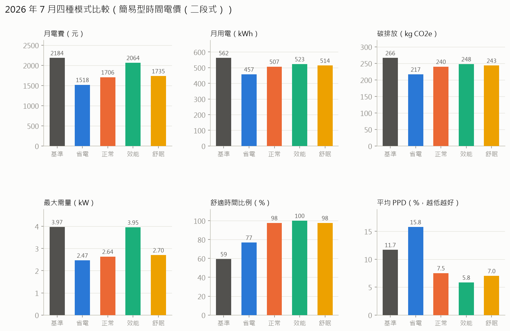

# 2026 年 7 月 HEMS 模式比較與節省建議

- 房型：標配房型（3 房 2 衛），4 人
- 電價方案：簡易型時間電價（二段式）（各模式依此方案最佳化）
- 天氣：中央氣象署臺中測站逐時觀測資料
- 碳排係數：0.474 kg CO2e/kWh（經濟部能源署 113 年度（2024）電力排碳係數）

## 模式比較

| 模式 | 月用電(kWh) | 簡易型時間電價（二段式）(元) | 簡易型時間電價（三段式）(元) | 非時間電價（累進電價，住宅用）(元) | 平均舒適時間比例(%) | 平均溫差(°C) | 最大需量(kW) | 碳排放(kg) | 平均PPD(%) | PMV舒適比例(%) | 月電費節省(%) |
|---|---|---|---|---|---|---|---|---|---|---|---|
| 基準（一般習慣） | 562.0 | 2183.6 | 2647.3 | 1714.0 | 59.3 | 1.7 | 4.0 | 266.4 | 11.7 | 5.9 | 0.0 |
| 省電模式 | 457.5 | 1518.3 | 1742.2 | 1233.4 | 76.8 | 1.6 | 2.5 | 216.8 | 15.8 | 55.2 | 30.5 |
| 正常模式 | 506.7 | 1706.1 | 1957.2 | 1429.4 | 97.6 | 0.8 | 2.6 | 240.2 | 7.5 | 93.7 | 21.9 |
| 效能模式 | 523.0 | 2064.1 | 2498.0 | 1513.5 | 100.0 | 0.7 | 4.0 | 247.9 | 5.8 | 100.0 | 5.5 |
| 舒眠模式 | 513.6 | 1734.8 | 1990.5 | 1464.8 | 97.6 | 0.6 | 2.7 | 243.4 | 7.0 | 93.6 | 20.6 |

## 節省建議（依每月可省金額排序）

1. **綜合建議：每月約省 754 元（55 度）**  
   改用正常模式並換成非時間電價（累進電價，住宅用）：每月電費 2184 → 1429 元（−35%），碳排放減少 26 kg CO2e，舒適時間同時由 59% 提升到 98%。  
   ※ 以下各項建議彼此有重疊，請勿直接相加。
2. **改用正常模式：每月約省 478 元（55 度）**  
   在舒適時間 ≥ 95% 的模式中電費最低；舒適時間由 59% 變為 98%，PMV 舒適比例 6% → 94%。  
   ※ 包含冷氣設定最佳化與可移轉負載排程。
3. **改用非時間電價（累進電價，住宅用）：每月約省 277 元（用電量不變，省在電價）**  
   以正常模式的用電模式計算，非時間電價（累進電價，住宅用）每月 1429 元，比目前的簡易型時間電價（二段式） 1706 元便宜。原因：冷氣多在晚間尖峰使用且無法移轉，時間電價的離峰優惠用不到。  
   ※ 以已改用推薦模式為前提，可與「改用模式」相加。
4. **熱水與洗衣移到離峰：每月約省 247 元（用電量不變，省在電價）**  
   電熱水器、洗衣機、烘衣機用定時器排在離峰時段（已計入熱水器提早燒的散熱損失），並錯開運轉以降低最大需量。  
   ※ 已包含在「改用正常模式」的節省中。
5. **耗電大戶：電熱水器（占 15%）：每月約省 236 元（61 度）**  
   電熱水器換成熱泵熱水器（COP 約 3–4）（設備投資，需評估回收年限）。  
   ※ 以基準用電估算；設備改善與行為改善可疊加，但比例會縮小。
6. **耗電大戶：冷氣（占 48%）：每月約省 159 元（41 度）**  
   冷氣換成一級能效變頻機，並定期清洗濾網（設備投資，需評估回收年限）。  
   ※ 以基準用電估算；設備改善與行為改善可疊加，但比例會縮小。
7. **冷氣調高 1°C：每月約省 131 元（37 度）**  
   冷氣設定從 25°C 調到 26°C，冷氣用電減少 14%。經濟部建議冷氣設定 26–28°C。  
   ※ 不想改用模式時，只做這一步的效果；已包含在「改用模式」的節省中。
8. **耗電大戶：冰箱（占 7%）：每月約省 29 元（7 度）**  
   冰箱勿過滿、門封條定期檢查；老舊冰箱汰換為一級能效（設備投資，需評估回收年限）。  
   ※ 以基準用電估算；設備改善與行為改善可疊加，但比例會縮小。
9. **避免入睡後過冷**  
   基準情境舒適時間只有 59%：入睡後代謝率下降，整夜維持低溫反而偏冷。可用舒眠模式讓設定溫度隨睡眠逐步調高、起床前回溫。

